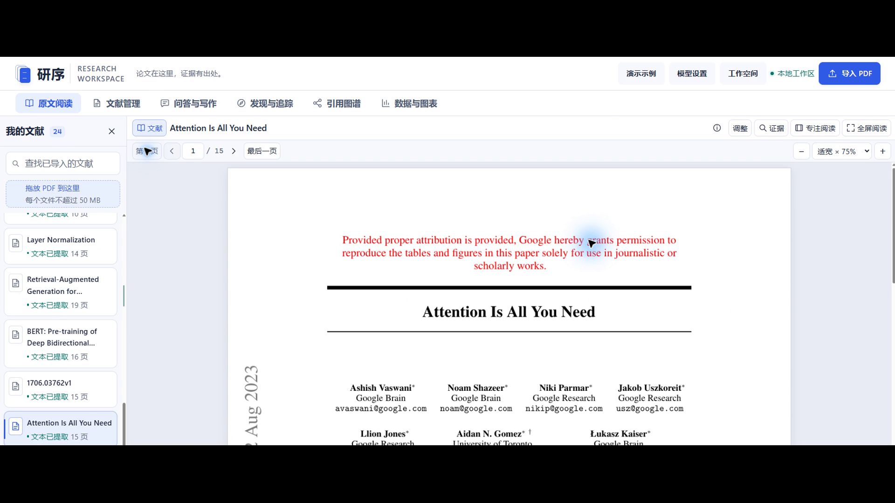
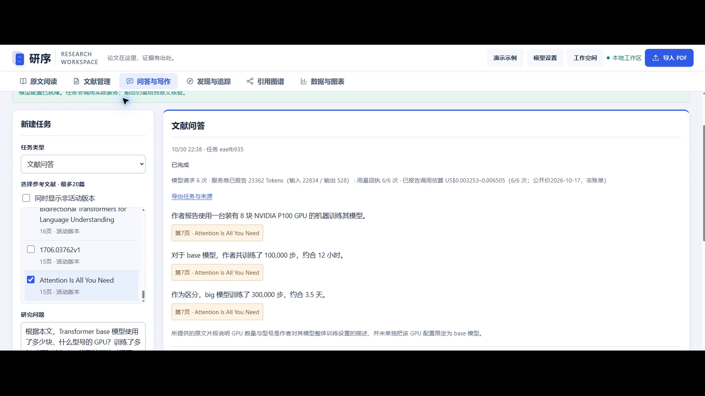
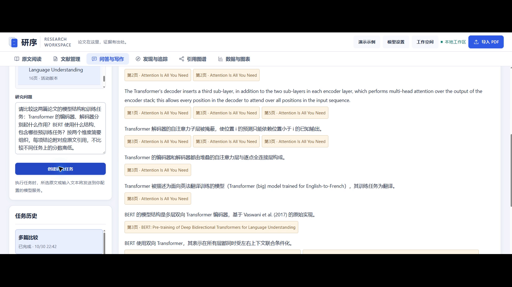
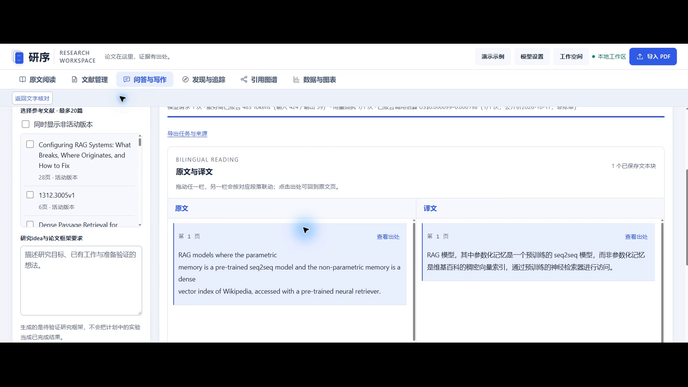
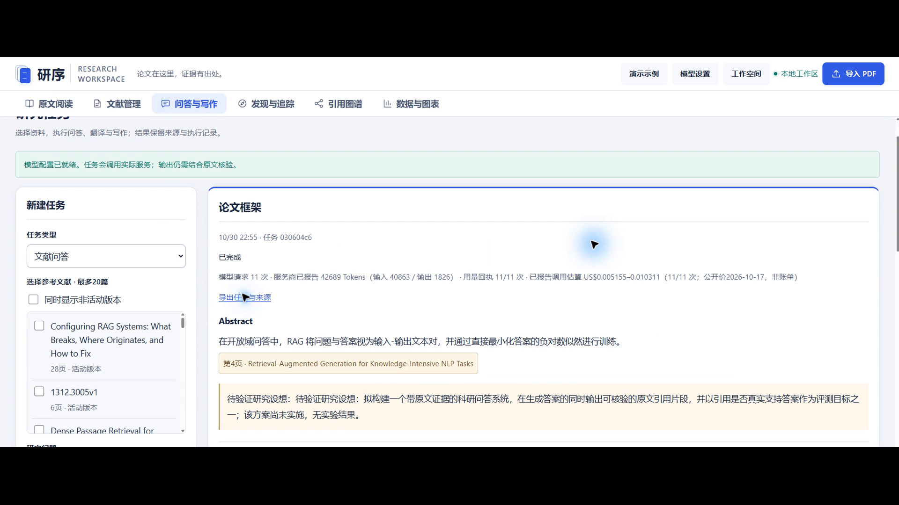
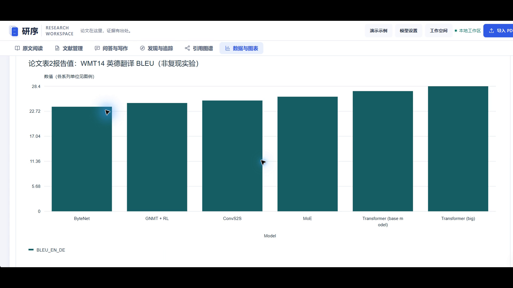

# 研序 可溯源科研助手 Agent

作品介绍文档

参赛者 郭剑宇　个人参赛　指导老师 无

赛项 第九届传智杯 AI大模型创新应用挑战赛

材料版本 2026年10月31日 v1

本文对应提交表单第6项的七项内容。应用说明以064dc58为基线；本次交付源码的冻结提交、文件摘要与完整Git历史以同包清单为准。文中区分已实现入口、实际演示证据和未验收范围，不以本地材料整理代替比赛提交。

## 1 项目详细介绍与使用方法

研序面向论文阅读、研究问答和写作整理。它将PDF原件、解析版本、文本页块、模型结论、原文引句和审核记录连接起来，让使用者在同一工作台阅读和核对资料。主要目标是减少来源身份混乱、相邻条目借用引用及版本变更后定位错误，便于判断一条回答究竟由哪段原文支持。

工作台包括原文阅读、文献管理、问答与写作、发现与追踪、引用图谱、数据与图表六个模块。用户可以导入论文，在阅读区缩放、拖动、全屏或按章节定位；围绕选定文献提问、比较或生成写作框架；查看研究方向的全文依据、引用关系及CSV图表。模型辅助整理科研资料，最终科研判断由使用者完成。

### 1.1 一次典型使用流程

- 导入资料：上传单篇或批量PDF，保留原件并查看解析状态。重复或版本候选只提供核对入口，不因主题相似直接合并论文。
- 阅读核对：选择文献和页码，结合原页、正文分块与预览核查。每篇文献保留阅读页码，引用跳转后可返回继续阅读。
- 建立研究任务：选定文献及解析版本，输入需要核对的问题，启动问答、多篇比较、综述或论文框架任务。
- 检查结果：阅读每条结论自己的引句，进入对应原文位置，并核对审核记录。缺少依据的维度保留缺口，不借相邻结论补证。
- 整理输出：按需要导出框架、参考文献或图表。图表报告值、原始CSV与本项目测试数据分别说明来源。

### 1.2 当前运行方式

当前验证环境是Windows、本项目专用Python虚拟环境和本地浏览器工作台。首次运行需按源码README准备依赖、OCR语言数据和向量模型；这些大体量资源及私人数据库不随源码包再分发。启动命令为scripts/start.ps1，正常本地地址为http://127.0.0.1:8765。在线生成需在本机模型设置中应用有效配置，真实密钥不随提交材料提供。

本次只整理本地交付文件。GitHub或Gitee评审访问地址、公网演示地址、必要账号和网盘分享链接仍需按实际状态落实。本地页面可打开、源码包可恢复，并不等于已完成公网部署或官方提交。

## 2 项目亮点

### 2.1 每条结论均有自己的核对入口

事实条目关联所选文献、解析版本、页块、区域和原文引句。多篇比较要求在当前条目内覆盖比较对象、数值及实验条件；相邻条目的引用不能代替当前条目的依据。来源成员检查与语义支持审核分别保留，避免把“引句确实存在”直接解释为“结论已被证明”。

### 2.2 阅读与研究操作连续衔接

阅读、翻译、问答、引用网络与绘图共用工作台和来源对象。原文预览在当前页面打开，关闭后继续核对当前文本；原文跳转提供返回入口，逐文献记住阅读页码。临时操作提示悬浮显示，降低结果变化对正文布局的干扰。

### 2.3 保留未知、失败与恢复边界

后台任务记录步骤、进度与检查点，失败后保留已完成内容。模型调用中断且结果未知时不自动重放可能已计费的请求；方向筛选只有在全文证据覆盖相应条件后才允许移出候选。复杂扫描结构不能确认时保留未知，不按邻项规律猜补。

上述亮点属于本项目的工程设计和使用方式，尚无真人长期效率实验，不宣称“零幻觉”、算法最优或已证实的时间节省比例。

## 3 AI测试技术落地使用情况概述

### 3.1 应用中实际使用AI的位置

应用接入DeepSeek完成受资料约束的问答、比较、翻译及研究写作。输入由用户任务、选定文献和冻结原文目录组成；模型按指定结构返回结果，应用随后核对结构、来源身份、引句成员、问题覆盖度及对应审核索引。引句通过quote_id从原文目录回填，减少模型重新抄写造成的字符偏差。

界面保留Flash与Pro配置路径。用户已取消后续Pro付费复测；本轮文档整理不调用模型，不以“保留配置入口”表述为Pro已通过最终验收。真实密钥只通过本机配置入口使用，不进入文档、源码历史或视频。

### 3.2 真实演示任务与检查结果

2026年10月30日，在隔离演示页面实际创建四个deepseek-flash任务，共35次模型请求均返回HTTP 200。请求成功与回答正确分别检查；成片展示真实输入、执行过程、结果及原文核对，没有用手写或模拟答案替代模型输出。

|实际场景|完成及核对范围|Flash请求|
|---|---|---|
|文献问答|3条结论及各自引句；区分Transformer整体硬件报告、base约12小时与big约3.5天|6次|
|多篇比较|11条结论、24处引句，核对文献、解析版本、页块、区域与最终审核索引|17次|
|选文翻译|RAG第1页183字符选文，核对双语结果、来源位置与完成检查点|1次|
|论文框架|3节框架、6条事实、7处引句和3篇实际参考文献，研究设想与事实分开|11次|

问答、比较及框架按各条事实自己的引句和审核记录核对。翻译保留保护标记、数字和目标语言检查，没有逐条事实语义审核，不能将其描述为采用相同审核机制。比较中仍有一条英文结论，框架的Related Work略超请求句数，当前页面也保留重复的研究设想提示；没有为视频改写这些真实回答。

### 3.3 本地工程测试与未验收范围

2026年10月27日历史全量本地回归为1277项、97个测试文件，失败、错误和跳过均为0。该报告按原被测版本保留，本次不冒充重新执行的全量回归。四个Flash场景只覆盖所选公开论文与实际片段，不能外推到全部题型或最新研究完整闭环。

复杂低清扫描公式、矩阵、表格和图表内部结构、机构跨块续行、稳定通用跨语言检索与去重尚未完整实现或验收。新重型通道的持续并发、复杂长书译文联动、极端CSV排版、官方资料包、GitHub核验正例、真实多日追踪与推荐效果仍有待验收项。Pro复测取消后，相应质量缺口继续保留。

开发过程中，郭剑宇负责需求取舍、页面体验、问题反馈和方案确认；Codex等AI协同工具辅助编码、界面调整、测试排错和材料整理。实际Prompt以版本文件保留，专业整理说明不冒充当时原始对话；不公开完整私人聊天，也不获取或伪造模型隐藏推理。视频使用剪映原生男声，正常1倍速。

## 4 关键技术说明

### 4.1 来源对象与持久化任务

后端使用Python、FastAPI和SQLite，前端为HTML、CSS及JavaScript。文献导入建立document_id，解析建立run_id，页块再保存页码、block_id及bbox，引用关联quote_id。重新解析产生新的run，旧回答仍关联旧来源，避免历史引用被新解析覆盖。任务步骤和检查点持久化，执行、失败、取消及未知调用分别记录。

### 4.2 本地解析与混合检索

PyMuPDF处理原生PDF文本和几何区域，扫描内容结合项目内OCR数据。可验证的字体与字形对应用于有限字符恢复，无法确认的结构保留未知。检索结合BM25、英文BGE向量及RRF融合；中文问题可使用已有双语查询扩展，但扩展词只服务于搜索计划，不成为事实依据。

多语MiniLM、E5候选按模型指纹与索引隔离保存。当前开发题质量未达生产替换标准，稳定默认仍为既有英文通道，不能将候选下载或维数相同描述为通用跨语言能力已完成。

### 4.3 受约束生成与支持审核

模型以结构schema输出，应用按当前claim_index检查本条引句与审核记录。修复迭代保留自己的版本、来源和索引，不借旧轮次或相邻结论补证。流式正文先显示为待审核内容，正式可引用结果在检查结束后发布。来源正确与语义支持是不同条件，模型审核本身也需要质量验证。

### 4.4 数据隔离、图谱与绘图

账号分别保存文献、查询、笔记、任务及偏好。跨账号协同推荐默认关闭，主动加入后仅共享约定的公开论文标识与反馈投影，不共享个人全文和任务。引用图谱只把已确认关系作为边，局域PageRank不代表整个学界的重要性。CSV绘图保留源行、原始数值和单位，通过固定模板导出SVG、规范与Python脚本，不执行任意模型生成代码。

## 5 项目图片与真实页面说明

下列图片直接截取用户选定的v5真实页面演示视频，用于展示实际界面。画面没有重新绘制，图注只解释可见功能，不把历史结果当作新的模型调用。原视频为334秒、1920×1080、30fps；场景出处和图片摘要随交付校验清单记录。

图1 原文阅读与定位。文献列表、PDF页码、缩放和专注／全屏入口可见；单帧仅展示当时阅读状态。

图2 问答结果与原文引用。硬件、base训练时间和big训练时间三条回答分别保留来源入口；完整引句与跳转过程见选定视频。

图3 多篇比较。Transformer与BERT的结构结论分别保留原文来源。本图为长结果局部，不代表完整展示全部比较条目。

图4 选文翻译。RAG选段的英文和中文并排显示，保留查看出处与返回入口；本图不代替整篇论文翻译质量验收。

图5 论文框架。已有事实附来源，未实施方案标为待验证研究设想。本图为长结果局部，研究设想不是已完成实验。

图6 数据与图表。论文Table 2公开报告值绘为柱状图，并注明“非复现实验”。原视频右上导入按钮边缘不完整的视口限制原样保留，未补画界面。

## 6 此前发表及获奖情况

截至本次提交材料整理时，本作品未发表，未获得奖项。

## 7 项目基础与改进情况

本作品未基于其他既有项目改造，不存在需要单独说明的基础项目改进部分。开发使用第三方开源组件及AI协同工具，具体技术与协同范围见本文相关章节。

项目采用的第三方库、模型服务、OCR数据与公开论文分别按源码依赖、来源及版本清单说明。使用这些组件与“基于某个已有完整项目二次开发”分别核对，不用通用技术栈介绍替代项目基础说明。

本介绍文档与技术文档、源码历史和选定v5视频共同构成本地作品材料。公开视频平台链接、网盘分享链接、评审仓库与公网演示等外部条件按实际状态另行填写；本地文件准备完成不等于已经上传、公开发布或正式提交。
