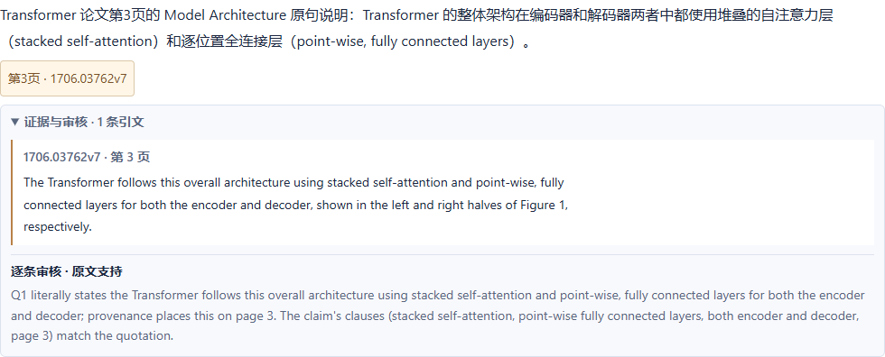
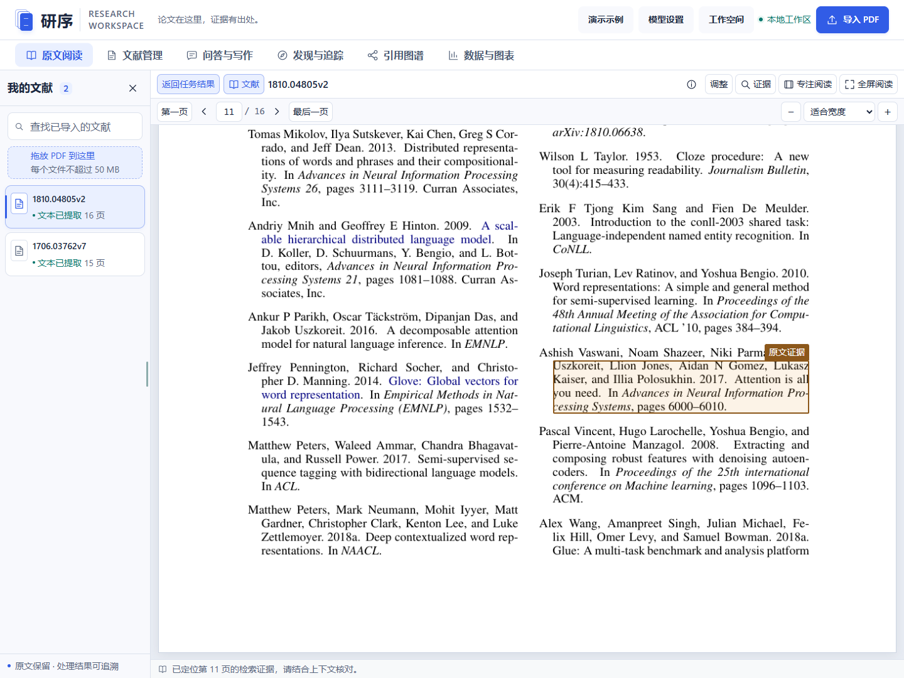
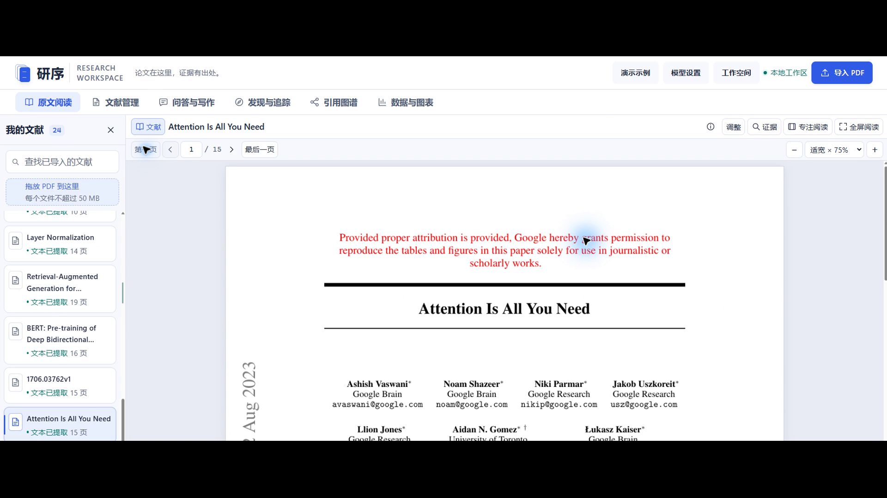
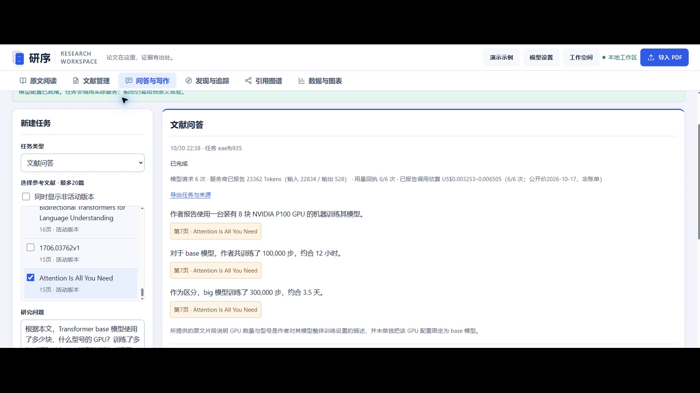
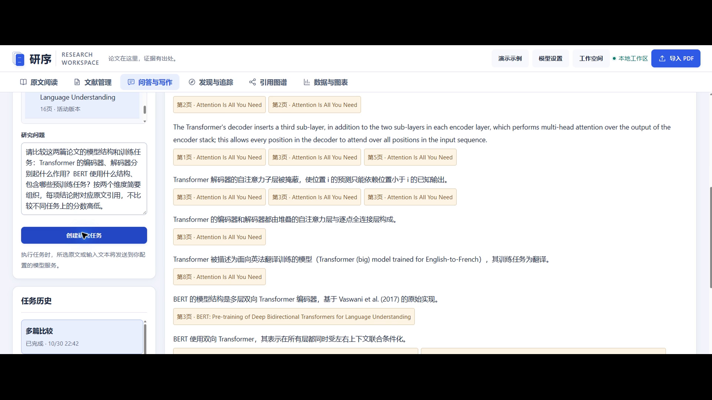
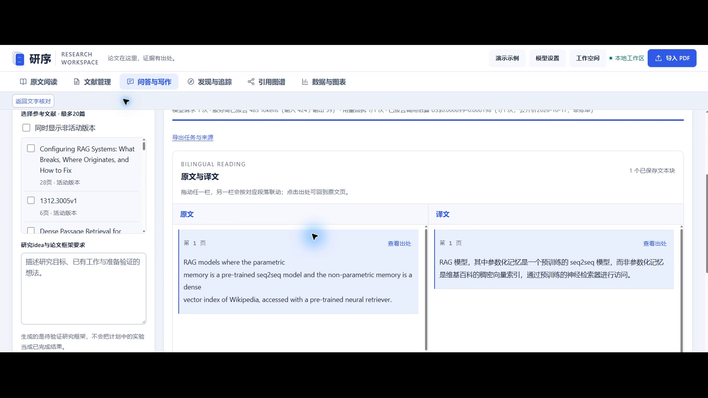
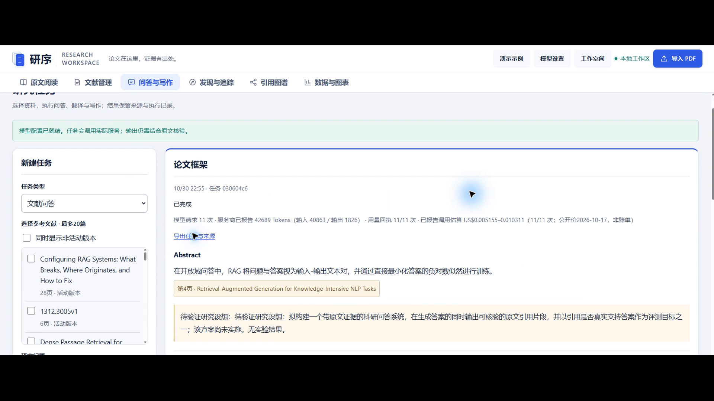
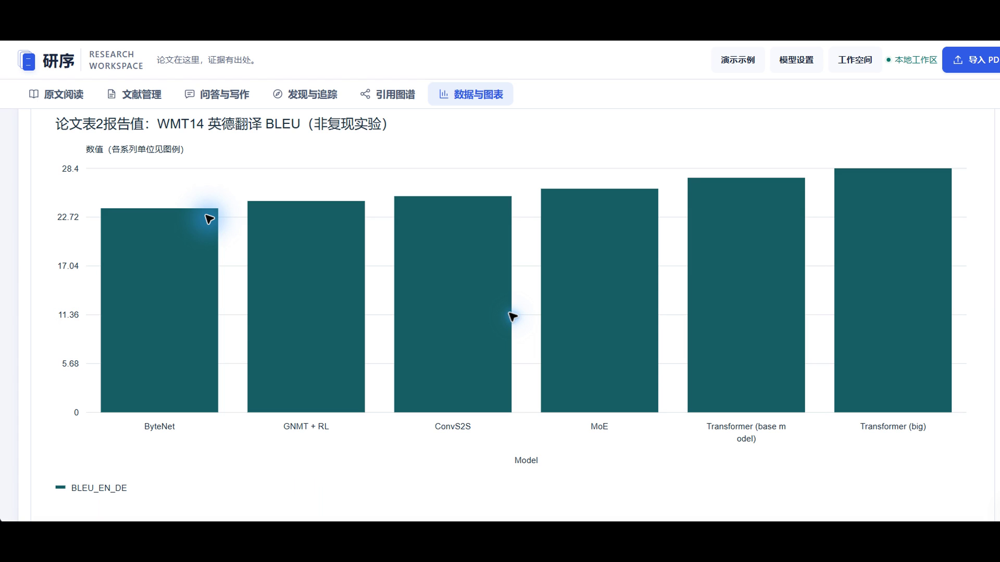

# 研序 可溯源科研助手 Agent

作品介绍文档

参赛者 郭剑宇　个人参赛　指导老师 无

赛项 第九届传智杯 AI 大模型创新应用挑战赛

材料版本 2026 年 11 月 11 日 v6

应用冻结提交 `3b4d6676f269fcbac58a3f792f72182cd509df62`

本文对应提交表单第 6 项的七项内容。2026 年 11 月 11 日的 Flash 验收和新版截图对应冻结提交。2026 年 10 月 30 日的 v5 视频及其中截取的界面图片对应历史应用基线 `064dc58`。

## 1 项目详细介绍与使用方法

研序面向论文阅读、研究问答和写作整理。它将 PDF 原件、解析版本、文本页块、模型结论、原文引句和审核记录连接起来，让使用者在同一工作台阅读和核对资料。主要目标是减少来源身份混乱、相邻条目借用引用及版本变更后定位错误，便于判断一条回答究竟由哪段原文支持。

工作台包括原文阅读、文献管理、问答与写作、发现与追踪、引用图谱、数据与图表六个模块。用户可以导入论文，在阅读区缩放、拖动、全屏或按章节定位，围绕选定文献提问、比较或生成写作框架，并查看研究方向的全文依据、引用关系及 CSV 图表。模型辅助整理科研资料，最终科研判断由使用者完成。

### 1.1 一次典型使用流程

- 上传单篇或批量 PDF，保留原件并查看解析状态。出现重复或版本候选时，可在文献管理中核对后确认。
- 选择文献和页码，结合原页、正文分块与预览核查。每篇文献保留阅读页码，引用跳转后可返回继续阅读。
- 在问答与写作中选择“智能研究（工具调用）”，设定选中文献和比较模式，输入待核对的问题。任务使用所选文献的固定解析版本，模型可调用原文检索及引用图谱工具。
- 展开每条结论的“证据与审核”，核对本条引句和审核记录，点击引用跳到 PDF 原文区域。依据不足的内容在结果中标明缺口。
- 在任务历史按文献和状态筛选，重新打开已完成的比较任务。通过该任务发起追问时，系统沿用原任务的文献与解析版本。查看原文后可返回当前任务，继续核对或导出结果。

### 1.2 当前运行方式

当前验证环境是 Windows、本项目专用 Python 虚拟环境和本地浏览器工作台。首次运行需按源码 README 准备依赖、OCR 语言数据和向量模型。执行 `scripts/start.ps1` 后可打开本地工作台 `http://127.0.0.1:8765`。在线生成需要在模型设置中应用可用配置。评审仓库访问地址、公网演示地址、必要的测试账号及网盘分享链接按实际发布状态填写。

## 2 项目亮点

### 2.1 每条结论均有自己的核对入口

事实条目关联所选文献、解析版本、页块、区域和原文引句。多篇比较的每条结论保留自己的引文。系统分别检查引文是否来自所选原文，以及该引文是否支持本条结论，并记录审核理由。涉及数值或实验条件的结论需要附上对应依据。

### 2.2 阅读与研究操作连续衔接

阅读、翻译、问答、引用网络与绘图共用工作台和来源对象。原文预览在当前页面打开，关闭后继续核对当前文本。原文跳转提供返回入口，逐文献记住阅读页码。临时操作提示悬浮显示，降低结果变化对正文布局的干扰。

### 2.3 固定版本追问和可核对的工具回执

比较任务保存文献与解析版本。即使之后重新解析 PDF，追问也沿用父任务固定的两份来源。任务历史支持按文献和状态筛选。打开历史结果后，工具回执、逐条审核与 PDF 原文位置仍可一起核对。

### 2.4 保留未知、失败与恢复边界

后台任务记录步骤、进度与检查点，失败后保留已完成内容。模型调用中断且结果未知时，界面保留中断状态，由使用者决定是否重试。方向筛选只有在全文证据覆盖相应条件后才允许移出候选。复杂扫描结构无法确认时保留未知。本轮验收关注具体任务的证据与流程，长期使用效率仍待验证。

## 3 AI 测试技术落地使用情况概述

### 3.1 应用中实际使用 AI 的位置

应用接入 DeepSeek 完成受资料约束的问答、比较、翻译及研究写作。在智能研究中，模型依据用户任务和固定文献范围选择工具。初始文献在本次任务内分配短编号 `D1`、`D2`，工具执行时映射回真实文献标识。任务结果继续使用原文献、解析版本和文本块标识定位。

模型按指定结构返回结果，应用随后核对输出结构、来源身份、引句、问题覆盖度及对应审核索引。引句通过 `quote_id` 从原文目录回填，减少模型重新抄写造成的字符偏差。每条结论均保留自己的审核记录和原文入口。

### 3.2 v6 真实 Flash 验收与本地测试

2026 年 11 月 11 日，使用 Transformer v7 和 BERT v2 两篇公开论文，在 `3b4d667` 完成一次真实 Flash 架构比较和一次追问。两条任务共 16 次模型请求，全部返回 HTTP 200。回答的事实支持和原文位置另行逐条核对。

|验收范围|实际核对结果|
|---|---|
|架构比较与追问|父任务比较两篇论文的架构，追问核对 Transformer 两端共同使用的两类层及 BERT 编码器。两条任务各输出每篇一条结论，共核对 4 条结论、6 处引文和各自的审核记录。|
|固定解析版本|父任务固定 Transformer 第 3 次解析和 BERT 第 1 次解析。Transformer 第 4 次解析完成后，追问仍沿用父任务的两份固定版本。|
|工具回执与原文定位|父任务 5 条、追问 3 条回执在任务日志、模型工具消息和最终结果中逐条一致。引文与对应 PDF 页、文本块和高亮区域一致。|
|任务历史与阅读返回|Edge 只读核验 58 项通过，覆盖按文献与状态筛选、重开并切换父子任务、展开审核、定位 PDF 和返回原任务。|
|本地定向回归|146 项通过，失败、错误和跳过均为零。|

首轮追问中，模型传入的 BERT 文献标识缺少末位字符，6 次工具调用返回文献超出任务范围，追问以证据不足结束。修复后，新父任务和追问的真实工具调用均使用 `D1`、`D2`。结果与定位继续使用原文献、解析版本和文本块标识。

### 3.3 v5 视频历史实录

2026 年 10 月 30 日，在应用基线 `064dc58` 的隔离演示页面实际创建四个 Flash 任务，共 35 次模型请求返回 HTTP 200。v5 成片保留真实输入、执行、结果和原文核对画面，配音为剪映原生男声，速度为 1.0 倍。

|实录场景|完成及核对范围|Flash 请求|
|---|---|---|
|文献问答|3 条结论及各自引句，区分 Transformer 整体硬件报告、base 约 12 小时与 big 约 3.5 天|6 次|
|多篇比较|11 条结论、24 处引句，核对文献、解析版本、页块、区域与最终审核索引|17 次|
|选文翻译|RAG 第 1 页 183 字符选文，核对双语结果、来源位置与完成检查点|1 次|
|论文框架|3 节框架、6 条事实、7 处引句和 3 篇实际参考文献，区分待验证研究设想与已有事实|11 次|

问答、比较及框架按各条事实自己的引句和审核记录核对。选文翻译的检查范围为保护标记、数字、目标语言与出处。旧版比较保留一条英文结论，框架的 Related Work 为四句，超出请求的二至三句范围，旧界面也保留了重复显示的研究设想提示。视频保留了这些实际生成结果。

### 3.4 验收范围与人机协作

2026 年 10 月 27 日的 1277 项本地回归和提交 `9207d2e` 的 1389 项全量回归按原被测版本留存。v6 的 146 项为本轮专项回归，真实 Flash 验收范围为上述两篇论文、架构比较及固定版本追问。

复杂低清扫描结构、机构跨块续行和通用跨语言检索与去重仍有待完善。重型通道持续并发、复杂长书的译文联动、极端 CSV 排版、官方资料包、GitHub 核验正例、真实多日追踪、推荐效果及公网部署仍有待验收项。本版 Pro 状态为未测。

开发过程中，郭剑宇负责需求取舍、页面体验、问题反馈和方案确认。Codex 等 AI 协同工具辅助编码、界面调整、测试排错和材料整理。实际 Prompt 按版本保存，技术文档记录调整依据和验证范围。

## 4 关键技术说明

### 4.1 来源对象与持久化任务

后端使用 Python、FastAPI 和 SQLite，前端为 HTML、CSS 及 JavaScript。文献导入建立 `document_id`，解析建立 `run_id`，页块再保存页码、`block_id` 及 `bbox`，引用关联 `quote_id`。重新解析产生新的 `run_id`，历史回答仍关联原版本。任务步骤、工具回执和检查点持久化，执行、失败、取消及未知调用分别记录。

智能研究任务的短编号只在当前任务范围内解析。工具回执记录状态和状态码，原文检索和图谱结果保存真实文献及固定解析版本。任务读取使用同一数据库快照核对状态和回执，任务历史可按文献与状态组合查询。

### 4.2 本地解析与混合检索

PyMuPDF 处理原生 PDF 文本和几何区域，扫描内容结合项目内 OCR 数据。可验证的字体与字形对应用于有限字符恢复，无法确认的结构保留未知。检索结合 BM25、英文 BGE 向量及 RRF 融合。中文问题可使用双语查询扩展，扩展词用于搜索计划，事实依据取自固定版本原文。

多语 MiniLM、E5 候选按模型指纹与索引隔离保存。当前默认使用已验收的英文向量通道，通用跨语言检索和去重仍待验证。

### 4.3 受约束生成与支持审核

模型按结构输出，应用按结论标识和索引检查本条引句及审核记录。修复迭代保留自己的版本、来源和索引。流式正文先显示为待审核内容，正式可引用结果在检查结束后发布。验收分别核对来源身份、原文位置和对结论的支持情况。

### 4.4 数据隔离、图谱与绘图

账号分别保存文献、查询、笔记、任务及偏好。跨账号协同推荐默认关闭，主动加入后仅共享约定的公开论文标识与反馈投影。引用图谱以已确认关系为边，PageRank 用于当前局域图谱。CSV 绘图保留源行、原始数值和单位，通过固定模板导出 SVG、规范与 Python 脚本。

## 5 项目图片与真实页面说明

### 5.1 v6 实测界面

图 1 至图 3 为 2026 年 11 月 11 日在 `3b4d667` 验收时保存的实际页面截图。

图 1　追问结论、原文与逐条审核。Transformer 第 3 页原句同时支持编码器和解码器共同使用堆叠自注意力层与逐位置全连接层。

图 2　追问工具回执。实际执行构建引用图谱和两次原文检索，界面展示状态、状态码和耗时。

图 3　引用图谱定位 BERT 第 11 页。高亮区显示指向 Transformer 论文的参考文献，阅读区提供“返回任务结果”。

### 5.2 v5 历史实录画面

图 4 至图 9 截取自 2026 年 10 月 30 日 v5 演示视频，录制应用基线为 `064dc58`。原视频为 334 秒、1920×1080、30 fps，图片来源时间及摘要随历史材料保存。

图 4　原文阅读与定位。文献列表、PDF 页码、缩放和专注及全屏入口可见。

图 5　问答结果与原文引用。硬件、base 训练时间和 big 训练时间三条回答分别保留来源入口。

图 6　多篇比较结果局部。Transformer 与 BERT 的结构结论分别保留原文来源。

图 7　选文翻译。RAG 选段的英文和中文并排显示，保留查看出处与返回入口。

图 8　论文框架局部。已有事实附来源，待实施方案标为待验证研究设想。

图 9　数据与图表。论文 Table 2 公开报告值绘为柱状图，图中标明“非复现实验”。图像保留历史录屏右上角按钮的视口裁切。

## 6 此前发表及获奖情况

参赛者在 2026 年 10 月 31 日确认，本作品未发表，未获得奖项。

## 7 项目基础与改进情况

本作品未基于其他既有项目改造。开发使用第三方开源组件及 AI 协同工具，具体技术与协同范围见本文相关章节。第三方库、模型服务、OCR 数据与公开论文按源码依赖、来源及版本清单说明。

新版作品介绍与 `3b4d667` 的技术文档、源码历史和 Flash 验收材料相互对应。选定 v5 视频保留 `064dc58` 应用基线的实际操作。公开视频平台链接、网盘分享链接、评审仓库与公网演示按正式提交时的实际状态填写。
