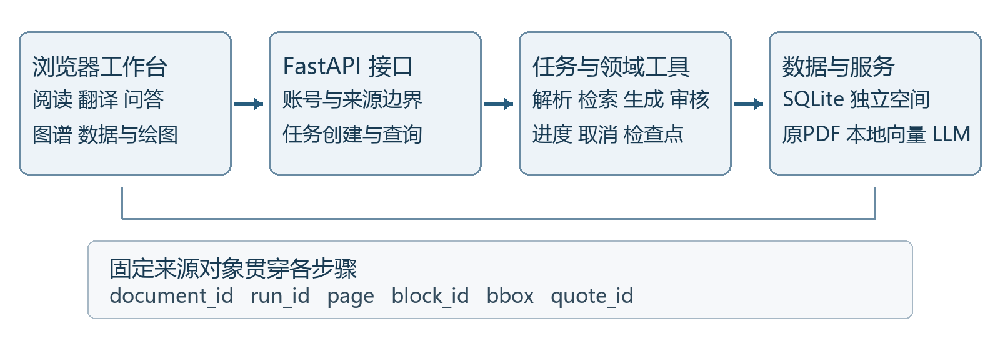

# 研序 可溯源科研助手 Agent 技术文档

参赛者 郭剑宇　　个人参赛　　无指导老师

第九届传智杯 AI大模型创新应用挑战赛

提交候选 v6　　2026年11月11日

候选分支 `codex/function-calling-agent`

源码冻结提交 `3b4d6676f269fcbac58a3f792f72182cd509df62`

研序将论文原件、解析版本、事实结论及逐条审核连接到同一工作台。使用者可从任一结论跳到自己的引文，并在原页核对后返回任务。任务历史保存比较与追问的来源关系，论文重新解析后仍可打开原任务使用的版本。

本版更新模型工具调用、引文审核和任务历史的一致性。对当前提交新建 BERT 与 Transformer 比较和追问，真实 Flash 验收核对了 4 条结论、6 处引文和 8 条工具回执。详细证据及测试边界见第 7 章。

本地候选包含冻结源码、完整项目 Git 历史、技术文档、Flash 验收和校验清单。既有演示视频及作品介绍的版本关系见第 11 章。

评审可免登录访问 [GitHub 仓库](https://github.com/guojianyu0806/research-workspace)。

## 1 项目概述

科研阅读经常需要在PDF、翻译工具、笔记、论文检索和写作界面之间切换。模型即使给出顺畅回答，也可能混用论文版本、遗漏实验条件，或者把相邻条目的出处当作本条结论的依据。研序将这些问题归结为两个工程目标：保留可追踪的输入来源，并在结果展示和任务恢复时保持来源身份稳定。

典型流程是导入公开论文、查看解析状态、在阅读区核对正文，围绕选定文献建立问答或研究任务，再从每条结论进入原文。使用者也可整理多篇论文的局域引用网络，检查研究方向的全文依据，或把论文报告值录入CSV绘图。应用始终区分作者报告的数据、本项目的工程测试数据和尚未执行的研究计划。

项目采用本地Web工作台形态。当前开发与验收环境是Windows和项目专用Python虚拟环境。在线模型承担语言生成与支持审核，本地工具承担文献管理、解析、向量计算、检索、图谱与绘图。网络不可用、模型未配置、解析不足和任务失败分别记录，避免把不同原因归为同一个空白结果。

目标使用者是需要核对论文原文的学生和研究人员。系统提供辅助阅读与整理能力，科研事实仍需使用者判断；本项目尚无真人长期效率实验，不宣称节省了某一比例的时间，也不以“零幻觉”描述当前能力。

## 2 需求分析

赛题要求完整覆盖六个功能模块，并以实际交互和可复现资料验证。下表列出已有入口与主要边界，模块存在不等于任意输入已验收通过。

|模块|当前实现内容|主要边界|
|---|---|---|
|文献管理与解析|单篇及批量PDF、原件保留、版本确认、解析历史、OCR、章节及有限公式表格结构|低清扫描、复杂嵌套矩阵、图表内部语义与机构跨块续行仍不完整|
|抗幻觉问答|固定文献问答、多篇比较、混合检索、逐结论引用和支持审核|当前 Flash 验收覆盖指定论文的比较与追问，Pro 与其他场景另列验收状态|
|阅读与翻译|首末页、页码记忆、缩放拖动、全屏、章节定位、原页预览及双语联动|复杂长书译文联动与专业语言质量未全面验收|
|发现与追踪|公开论文检索、选定全文导入、订阅、偏好反馈和主动加入的协同重排|真实多日效果、GitHub核验正例及部分外部失败恢复待验收|
|图谱与研究综合|引用边、PageRank、综述、全文条件核验和可恢复方向筛选|不能据有限检索证明某方向普遍已解决或没有新研究|
|写作与绘图|论文框架、真实参考文献、CSV图表、结构图和固定模板脚本导出|不执行任意模型生成代码；极端CSV排版仍待补充验收|

非功能需求包括账号数据隔离、历史引用稳定、长任务取消恢复、真实流式传输和可理解的失败提示。重新解析不得把旧答案指向新片段；未知付费调用不得在后台自动重放；证据不足时必须保留缺口，不能通过删除未回答内容提高表面完成率。

交付要求覆盖代码托管、真实 Git 历史、技术 PDF、演示视频和公网演示。评审可通过第 11 章的仓库入口检查源码和提交。

## 3 系统架构与数据流程

系统由浏览器工作台、FastAPI接口、持久化任务及领域工具组成。前端使用HTML、CSS和JavaScript，后端使用Python；SQLite保存各账号空间的文献、解析、研究任务、数据集及偏好。PDF原件、派生页面和检索缓存分别管理，便于恢复和检查。



图1 研序既有工作台与来源关联示意。当前工具编排与任务历史的改动见正文。

### 3.1 固定来源对象

文献导入先保留内容摘要与原件，再建立解析run及逐页任务。解析产生的文本块关联document_id、run_id、页码、block_id和bbox区域。研究任务从选定解析构建冻结来源集合；答案引用再关联quote_id及原文字符。文献身份、解析版本和区域均参与核对，同名论文或另一个账号的数据不能替换当前来源。

重新解析建立新的run，旧引句仍指向原run。阅读区、问答、翻译、综述和审核共享来源标识，避免各模块分别猜测页码或按旧序号关联新结果。检索分数用于候选排序，不是事实可信度；来源成员核对与结论支持审核是不同步骤。

### 3.2 模型工具调用与任务状态

用户选择文献后，服务将文献和各自的可用解析版本存入任务范围。规划模型按需调用原文检索、引用图谱等工具，随后由独立步骤生成答案、校验引文、审核结论并检查问题覆盖。公开检索、导入和解析查询分别受用户授权的参数及配额限制。

初始文献以 D1、D2 等任务内短编号提供给模型。工具执行时精确映射到授权文献，检查文献状态、账号范围和固定解析版本。已保存的工具对话及成功导入回执仍可使用完整文献标识。原文证据、图谱、任务记录和 PDF 定位始终使用真实文献与解析标识。

工具检查点与回执同一事务保存，任务详情与摘要各自使用一致的数据库快照读取。工具结果超出模型消息容量时，模型收到的状态、任务记录和界面显示对应同一失败回执。排队、执行、失败、取消和完成保留各自状态。服务端结果未知时，历史记录提供明确重试入口。

### 3.3 账号与协同边界

普通账号各自保存文献、正文、查询、笔记、研究任务和偏好。跨账号协同推荐默认关闭，用户主动加入后仅共享约定的公开论文标识与反馈投影，个人全文和任务不共享。群体汇总不等于完全匿名，真实推荐效果需另做长期评估。

本地默认空间的模型设置限于本机配置入口，真实密钥不写入交付文档或公开仓库。当前运行方式仍是本地服务；公网使用需要在独立评审空间、访问控制及运维安排明确后实施。

## 4 AI技术选型与集成

### 4.1 在线模型的选择理由

项目既有接入使用DeepSeek服务。界面配置当前限定deepseek-flash和deepseek-v4-pro，接口地址限定官方DeepSeek端点；环境变量方式与统一模型调用类承担后台请求。选择这一接入路径是为了复用同一套Chat Completions请求、结构校验、错误处理和使用量记录，并在已有配置基础上迭代任务逻辑，减少多服务切换带来的集成差异。

模型档位作为运行配置保存。当前候选的线上验证使用 `deepseek-flash`，范围为两篇公开论文的一组比较和追问。Pro 配置路径保留在应用中，本版 Pro 验收状态为未测。现有记录没有跨厂商或跨档位的受控对照，质量判断以实际问题、引文和审核为依据。

费用控制由请求范围、有限上下文、调用记录、取消边界及未知结果处理共同完成。配置密钥本身不会发起验证请求，读取已保存结果也不等于重新调用模型。界面与材料会把真实新调用、历史模型结果和本地工程测试分开说明。

### 4.2 本地检索与解析工具的选择理由

|组件|采用理由与集成方式|约束与代价|
|---|---|---|
|英文BGE向量与BM25|向量查找措辞不同的段落，关键词保留专名和数字线索，再用RRF融合排名|排名不是概率；英文模型不被描述为通用跨语言模型|
|FastEmbed与本地ONNX|在本机生成文献向量，模型文件和指纹与索引绑定|需显式准备权重，首次安装和异机表现另行验收|
|PyMuPDF与项目内OCR数据|结合原生文本、字形、几何区域和扫描识别，结果可关联原页|低清及复杂数学结构不能仅靠通用OCR完整恢复|
|FastAPI与SQLite|接口、任务和来源对象便于组织；本地空间可保留事务和恢复记录|当前单进程本地部署方式不代表已通过公网多实例验收|

中文问题可用已有双语查询词扩展辅助检索英文资料。扩展词只用于搜索计划，不是事实依据；生成失败后使用原问题继续检索。该机制不能被称为已完成通用原生跨语言检索。

MiniLM与E5候选在明确授权下保存到项目目录，没有覆盖稳定英文模型。候选指纹分别绑定权重、查询前缀、输入长度、分块和池化方式；维数相同也不复用旧向量。真实开发题的候选质量尚未达标，因此没有替换生产默认通道。

### 4.3 从用户问题到可引用结果

用户先选择文献及解析版本。应用按问题维度规划检索词，执行本地候选检索，生成限定长度的冻结原文目录。模型接收任务约束、目录和结构schema，输出事实条目、引用选择及缺口说明；它不能把请求或论文中的嵌入指令当成系统要求。

回答阶段向模型提供带编号的原文目录。Agent 问答可用短引用编号选择片段，后台回填规范原文，保留正式结果中的 `quote_id` 和来源定位。直接提供引句时，文本须与完整目录片段或未截断整块原文对应。按长度截开的残片不进入生成目录，避免丢失否定语或限定条件。结论改写后仍需检查其自身引句是否足以支持表述。

审核以当前结论的位置与身份对应。局部纠正同时记录原尝试和结果位置。即使两条纠正后的内容相同，也各自保留指向，删去前项时同步更新后续索引。

一条比较结论可以引用多段原文，但必须在本条结论内覆盖比较对象、数值和实验条件。相邻结论、未引用正文或模型记忆不能补齐当前条目缺少的证据。某个问题维度确实没有依据时，应明确保留缺口，而不是把该维度删除后宣称完整。

### 4.4 优化策略与失败处理

优化重点是收紧可验证边界。模型输出使用结构schema；原文引句由quote_id回填；数值表格须同时保留行、列、指标及任务范围；审核按claim_index关联当前结论，历史轮次保留自己的索引和来源。修复输出不能悄悄改变请求维度或借用相邻条目的引用。

联网异常、认证失败、余额不足、限流、截断和结构无效分别显示。流式生成中的正文先视为待审核内容，正式可引用结果在结构与审核流程结束后发布。连接中断且服务端结果未知时不自动重试；有限修复尝试失败后保留原因和已完成检查点。

这些措施有助于减少无依据输出，不构成“零幻觉”保证。来源成员正确只能证明引句来自相应文献，不能单独证明结论得到充分支持；模型支持审核本身也可能出错，需要逐任务质量验收。

## 5 核心功能实现

### 5.1 文献管理与解析

PDF原件按内容摘要保存，重复导入、版本候选提示和确认关系分开处理。主题相近不能直接合并，身份冲突保持待核对；用户确认后可以撤销关系，旧原件和历史引用不物理覆盖。语义相似分数用于发现候选，不作为论文同一性的最终证明。

解析同时保留可见文字、章节和区域。原生字体恢复仅在内嵌字体、实际字形编号和位置可对应时应用；例如phi变体修复保留原字符、恢复字符、字体摘要及字形编号。无法识别的公式、矩阵元素或小数保留未知标记，不按邻项规律猜补。这些局部方法不能代表通用扫描公式已经解决。

### 5.2 阅读与双语联动

阅读区支持首末页、逐文献页码记忆、缩放拖动和全屏。管理区小图可在当前页面放大，关闭后继续核对原段落；引用跳转提供返回入口。章节定位尽量保持目标位置，提示采用悬浮显示，避免临时状态把正文挤动。

长双语结果采用分页和窗口渲染，每栏保留有限正文DOM，并按来源标识与位置锚点恢复。无唯一标识、重复标识或历史记录被替换时，不按旧序号猜测新来源。联动工程正确性、专业术语和译文语言质量分别验收，前者通过不代表后者已全面通过。

### 5.3 问答与研究写作

问答、多篇比较、综述和论文框架共用固定来源与逐条审核。事实与研究计划分开保存，参考文献从实际文献记录生成；图表数值、作者机构、模型结构和训练目标保留各自的范围条件。不把不同任务、不同数据集或不同模型变体的分数直接解释为总体优劣。

任务历史支持按文献和状态筛选，并可重新打开比较和追问结果。历史任务显示各条结论自己的引文、审核和工具执行记录。进入 PDF 时同时带入文献、解析版本、页码和区域。切换任务会作废旧引用尚未完成的导航请求，避免旧请求的返回位置被新任务接管。

从比较结果发起追问时，服务保存来源任务标识并沿用其文献与解析版本。第 7 章记录了先生成比较、再重新解析论文、最后发起追问并从历史打开两条任务的实测。

### 5.4 发现追踪与方向筛选

公开论文检索、选定全文导入和订阅形成可保存检查点的流程。用户偏好反馈可影响重排；推荐理由需保留相关性或代码核验等实际依据。真实多日追踪效果、GitHub核验正例及推荐成效尚未全面验收，不能仅凭一次成功请求外推长期稳定性。

未来方向核验把待检查条件逐条关联到选定全文。证据只覆盖部分条件、解析未完成、结论需要跨篇拼接或来源不足时，不能直接把方向移出候选。原方向和审核记录保留，可恢复筛选状态。最新研究实时检索、全文核验至自动方向筛选仍有模型质量与外部闭环未验收项；本版 Flash 验收范围为指定论文的比较和追问。

### 5.5 图谱与数据绘图

图谱只将已确认的来源关系作为引用边，待确认关系另行保留。PageRank用于描述当前局域网络，不能代表整个学界的论文重要性；节点和边的数量也不表示全部引用关系已召回。

CSV数据保留源行、原始值、系列和单位。极端值处理仅影响绘制归一化，不改写原数据；图形可导出SVG、规范和固定模板Python脚本。结构图保留节点全文及有向连接。三维分层雷达图的高度表示系列类别，不宣称新增实验测量维度；图注不自行生成因果关系或统计显著性。

## 6 AI协同与Prompt优化

郭剑宇负责需求取舍、页面体验、问题反馈、实施优先级及配置选择；Codex等AI协同工具辅助代码、界面、测试、排错和材料整理。提交视频使用剪映原生朗读生成正常1倍速男声旁白，画面来自真实软件录屏。项目保留真实增量Git历史，不把AI实现和测试改写为纯人工独立开发，也不公开完整私人聊天或获取、伪造模型隐藏推理。

Prompt按任务目标、输入材料、来源约束、输出结构和验收条件组织。论文正文与用户请求是待处理内容，不能覆盖固定规则。实际运行文件及版本保留在源码，事后整理的中文说明与实际模板分开标识。

|实际模板|关键约束|源码位置|
|---|---|---|
|工具规划 agent-function-calling-v2|初始文献使用任务内短编号，公开操作限定在本任务授权范围|research_workspace/prompts/agent_tools_v2.txt|
|问答 research-evidence-v5.8|按问题维度回答，逐结论选择引文片段，保留模型范围和表格条件|research_workspace/prompts/qa_v5.txt|
|支持审核 grounding v3.2|按当前claim_index检查本条引句，不接受邻条补证，并报告未覆盖维度|research_workspace/prompts/grounding_v3.txt|
|检索计划 retrieval query v2.3|按所问属性分配检索词，扩展词不作答案或证据|research_workspace/prompts/retrieval_query_v2.txt|

典型优化从可观察失败出发：引句重新抄写出现差异时，改由来源目录回填；结论只在相邻条目有出处时，收紧逐条支持约束；多轮修复的索引与审核错位时，分别保存每轮对象和对应记录；未回答维度被丢弃时，加入完整性检查和受约束补检索。代码、模板与测试共同修改，不能仅以Prompt文字更长就宣称效果更好。

质量记录按任务和源码版本解释。原始失败记录与修复后的成功记录分别保留，提交候选仅选取必要的公开论文验收材料。作品介绍与演示视频的既有版本见第 11 章。

## 7 测试与验收

### 7.1 当前候选的真实 Flash 验收

2026年11月11日，在冻结提交 `3b4d667` 启动隔离服务，使用真实 `deepseek-flash` 新建比较任务，并以该任务为来源创建追问。样本为 Attention Is All You Need（arXiv 1706.03762v7）和 BERT（arXiv 1810.04805v2）。比较要求分别说明两篇论文的架构，追问核对 Transformer 编码器和解码器共用的层类型，并再次核对 BERT 编码器架构。

|场景与任务编号|验收内容|实际请求|
|---|---|---|
|比较 `9e2fc6ae`|2 条结论、4 处引文、5 条工具回执；1 条局部纠正按原位置和最终位置核对|10 次 HTTP 200|
|追问 `e6aea4e3`|2 条结论、2 处引文、3 条工具回执；固定为父任务使用的两个解析版本|6 次 HTTP 200|

两条任务的工具调用使用 D1、D2，执行回执仍对应真实文献和解析版本。逐条比对模型收到的回执、任务日志及最终结果的状态与状态码。原文验证检查引句、文献、解析版本、物理页、块标识和高亮区域。Edge 通过 58 项检查，覆盖文献与状态筛选、从历史重开比较和追问、展开审核、跳转 PDF 及返回同一任务。

比较锁定 Transformer 第 3 版和 BERT 第 1 版。生成比较后，Transformer 重新解析到第 4 版。追问的检索、图谱和引文继续使用父任务锁定的版本。随包 `02_Flash验收` 提供任务身份、回执对照、原文定位与浏览器核验的公开副本。

### 7.2 失败、修复与本地验证

提交 `9207d2e` 的首轮实测中，Flash 重复漏抄 BERT 完整文献标识的末位。工具拒绝 6 次范围不符的调用，追问返回证据不足。修复引入任务内短编号，保持原有权限和固定版本校验。新的比较和追问在提交 `3b4d667` 重新执行，通过第 7.1 节的验收。

当前提交运行 146 项专项本地测试，覆盖工具协议、权限边界、追问固定版本、引文审核、历史记录和 API。此前提交 `9207d2e` 已完成 1389 项全量本地回归，属于上一提交的记录。更早的 2026年10月27日 1277 项回归和 2026年10月30日视频中的四个真实 Flash 场景属于各自的历史版本。

### 7.3 当前验收范围

|验收项|状态|
|---|---|
|指定论文的比较、追问、审核、回执、原文定位与历史筛选|在 `3b4d667` 实测通过|
|Pro、官方资料包和外部最新研究全流程|未纳入本版验收|
|复杂低清扫描、通用跨语言检索、长书译文联动和极端 CSV|历史记录覆盖部分样本，仍待更广的独立验收|
|真实多日追踪、推荐效果、新通道长时并发及公网部署|继续按原范围保留待验收|

## 8 安装运行与复现

源码交付包括README、依赖清单、环境变量模板和启动入口。推荐Python 3.12，在项目目录创建专用虚拟环境。基础运行依赖包含FastAPI、Uvicorn、PyMuPDF、python-multipart、httpx和NumPy；开发清单通过引用加入FastEmbed及pytest。版本以随源码冻结的requirements与锁定清单为准，不用本文中的概括替代实际依赖文件。

```powershell
py -3.12 -m venv .venv
.\.venv\Scripts\python.exe -m pip install -r requirements-dev.txt
.\.venv\Scripts\python.exe -m pip check
.\scripts\start.ps1
```

浏览器访问http://127.0.0.1:8765。启动脚本使用一个Uvicorn worker，不应对同一数据目录开启多个实例。保持终端运行，按Ctrl+C停止。基础健康接口为/api/health；模型未配置时，应先确认基础页面与文献工具可用，再按需要配置在线服务。

隔离演示入口为 `scripts/run_submission_demo.py`，支持 `--enable-worker`。该脚本用于已准备的隔离演示空间，默认只浏览历史；只有显式启用该参数才运行真实PDF解析与研究后台，且仍须在该页面应用模型配置。它仅接受artifacts内带submission-demo-manifest.json的已准备目录，并使用独立端口。不要把个人资料库直接作为演示目录，也不要把缺少演示数据的源码包误称为一键复现视频环境。普通安装仍按start.ps1启动，数据和模型需按说明另行准备。

RESEARCH_DATA_DIR选择持久化数据目录；RESEARCH_MODEL_BASE_URL、RESEARCH_MODEL及RESEARCH_MODEL_API_KEY用于启动进程配置。也可在本机默认空间的模型设置界面应用配置。真实密钥不进入Git、文档、视频或公开分享，.env.example只提供变量名和非敏感默认值；宿主Python不会自动加载.env文件。

OCR语言数据和本地向量权重需显式准备，运行期不隐式下载。启动脚本可识别项目内已准备的OCR目录及稳定向量模型；缺少数据时相应通道显示不可用或降级。模型权重、OCR语言文件、公开论文原PDF、虚拟环境及私人数据库不随源码再分发，来源与冻结摘要见资料清单。

候选 ZIP 同时提供源码树、Git bundle 和恢复说明。用 bundle 克隆到新目录后，按说明核对冻结提交与完整提交数并执行 `git fsck`。异机首次安装与首次模型准备仍待独立复现。

## 9 部署方案与待执行条件

### 9.1 已验证的本地运行与未部署边界

当前启动脚本绑定127.0.0.1:8765，应用TrustedHost规则限于localhost与127.0.0.1。本地可打开不代表公网可达；仅将端口映射到公网也不能证明认证、来源隔离、HTTPS和评审账号已经准备妥当。GitHub 已公开源码与历史。应用公网部署尚未执行。

Dockerfile.submission与compose.submission.yaml目前是部署草案，未构建、未验收。草案使用独立数据卷、单worker、非root用户，并在模型和OCR未挂载时关闭相应通道。它说明拟采用的运行形态，不作为已经实现一键公网部署的证据。

### 9.2 实施顺序与复现检查

取得具体主机及部署授权后，先在独立评审数据空间准备Python或容器运行环境，再准备OCR和向量模型、验证固定公开论文的导入及原文定位。随后配置实际域名或允许使用的公网地址，按真实入口调整Host及反向代理规则，设置HTTPS和访问控制，最后提供独立评审账号并检查外网访问与长任务恢复。

后续部署验证记录至少应包含主机与运行版本、启动命令或镜像摘要、数据卷路径、非敏感配置项、外网健康检查、可登录的评审空间以及失败恢复结果。真实模型测试须针对具体目标另行授权并说明费用；后续Pro付费复测已取消，不能为补充文档或部署说明自行发起模型调用。

服务应覆盖评审期间的可用性，并安排重启、日志检查、备份和回滚。当前应用通过本地工作台运行，公网访问地址与评审账号将在部署并验收后提供。

## 10 技术创新与应用创新

技术方面，项目将文献身份、解析版本、页块、区域及逐结论引句连接为可检查的来源对象，并在草稿、正式结果、失败与未知调用之间保留状态边界。版本确认、方向筛选和协同推荐均强调可恢复和来源隔离。这些属于本项目的工程设计特点，不宣称提出新的基础模型、证明普遍学术新颖性或达到算法最优。

应用方面，同一工作台连接原页阅读、文字核对、研究比较、引用网络及数据绘图，返回原文后保留阅读位置。多篇结果要求各条结论自带出处，减少依赖相邻条目猜测依据的操作；不确定状态与缺口直接呈现，帮助使用者决定下一步核查。真实效果仍需用户研究和长期实验，不虚构效率提升或用户规模。

## 11 提交候选与资料对应

源码与 Flash 验收以 `3b4d6676f269fcbac58a3f792f72182cd509df62` 为基线。源码 ZIP 收录 694 个受 Git 跟踪的文件，包含可恢复 codex/function-calling-agent 和 main 两个分支的 Git bundle。冻结版本有 322 条提交，随包提供恢复说明与 SHA-256 校验。

评审可免登录浏览公开仓库、冻结源码和提交历史。上次核验记录为提交 2f1b1a6，共 323 条提交。GitHub 当前提交数量以提交历史页为准。

[GitHub 仓库首页](https://github.com/guojianyu0806/research-workspace) · [v6 冻结源码](https://github.com/guojianyu0806/research-workspace/tree/3b4d6676f269fcbac58a3f792f72182cd509df62) · [完整提交历史](https://github.com/guojianyu0806/research-workspace/commits/)

第 5 项填写完整作品目录的网盘分享链接及适用的提取码。第 6 项直接上传 v6 作品介绍 PDF。第 7 项填写 v5 视频的公开视频平台链接，视频记录 064dc58 上的实际操作。应用公网地址待部署后提供。

验收所用公开论文可按 arXiv 编号获取，模型权重与本地数据按源码运行说明准备。
