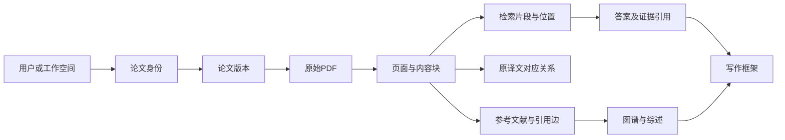

# 科研助手 Agent 实施规划与验收清单

本项目的交付目标是一款可公网访问、可实际操作、能核验输出依据的科研助手 Web 应用，覆盖官方六大功能模块，并同步完成源代码、技术文档和演示视频。开发主线是打通论文、版本、原文位置和引用之间的关系，再让问答、翻译、图谱和写作共同使用这些数据。

规划日期为2026年10月8日。依据为[官方赛道通知](https://www.boxuegu.com/matchTrack/detail/?id=10040)及同目录保存的官网快照 `比赛通知官网快照_2026-10-08_v1.json` 中的 `data.detailContent`。本文件是新的规划文件，不替换此前的比赛摘要。当前所有勾选框都是待办，没有表示功能已经实现或测试已经通过。

## 规划前提与完成标准

用户目前将每天可投入时间、技术基础、模型API与服务器预算均标为待定。因此本版给出组件职责、依赖顺序、阶段目标和调整方法，具体框架、模型、部署服务及价格在技术验证后确定。

省赛按官网列出的2026年11月18日截止准备，内部目标为11月16日具备正式提交条件；若校内截止更早，应整体前移。官网未给出当天截止时刻，也存在指导反馈时间与国赛时间顺序不匹配的问题，不据此推迟工作。

清单采用以下标记，防止把开发建议误写成赛事规定：

| 标记 | 含义 |
| --- | --- |
| 官 | 官方明确列出的功能或交付要求，最终须覆盖 |
| 评 | 官方评分考察点，应提供实现和效果证据 |
| 建 | 本项目建议采用的实现、测试或管理办法，可调整 |
| 增 | 官方高级表现或额外强化项，在基本覆盖后投入 |
| 核 | 原文含糊或相互矛盾，保留任务并确认验收口径 |
| 任选 | 官方列举多种实现或输出形式，可选择适合本项目的路径 |

清单条目中的验收办法属于我们的工作标准；官网没有公布准确率、延迟、并发或费用的量化合格线。本规划不把内部测试目标称为官方门槛。

一个功能只有在真实输入可运行、输出可核验、必要失败状态可解释、部署环境能复现并保存验证记录后，才标为完成。只有界面、按钮、截图或预先写好的回答，不能算功能完成。

## 最终需要交出的成果

| 成果 | 最终内容 | 完成判断 |
| --- | --- | --- |
| 在线科研助手 | 六模块、真实Agent流程、阅读器、文献库、任务状态及必要账号 | 从公网进入后，评审能使用自己的输入走通流程 |
| 源代码仓库 | GitHub或Gitee、完整真实提交历史、前后端代码、配置与运行指南 | 具备评审访问权；在新环境按README可以启动 |
| 技术文档 | 不超过30页的PDF | 讲清需求、架构、AI方案、创新、测试、部署及AI协同贡献 |
| 演示视频 | 5至8分钟、MP4、至少1080p、普通话讲解 | 展示真实功能和AI技术亮点，内容对应提交版本 |
| 验收证据包 | 测试输入、预期与实际结果、日志、图表、截图或短录屏 | 建议作为开发与答辩依据；不是官网单独规定的第五类提交附件 |
| 决赛答辩准备 | 架构讲解、Prompt审计记录、现场演示及故障解释 | 参赛者能独立解释关键设计、效果及限制 |

## 开发前的准备清单

- [ ] P01【官】确认正式学籍、个人参赛组别和报名信息；研究生、A、B、C组不得向下报名。
- [ ] P02【官/核】确认报名缴费状态、个人中心实际提交入口、校内节点、截止时刻和评审服务需保持可用的时间范围。
- [ ] P03【官】取得当前官方资料包，清点 `pdf/` 目录和补充说明，记录文件名、大小、页数与文件摘要值。暂缺时可用公开样例做预研，但官方兼容性验收保持待办。
- [ ] P04【建】准备固定样例：普通双栏论文、扫描版、同论文不同版本、541页教材、至少20篇相关论文、CSV和中文学术文本。
- [ ] P05【建】从样例中人工标注一小组正确答案和原文位置，包含数字、单位、实验条件、参考文献，以及确实无法从资料回答的问题。
- [ ] P06【建】记录可投入工时、机器配置、联网条件和费用上限；测试模型、OCR、检索来源与服务器是否可用，形成选型记录。
- [ ] P07【官/建】从首次开发起使用Git；同步保存需求变化、架构决策、关键Prompt版本、AI协同贡献与测试结果，不在最后补造开发历史。

## 六大模块的功能验收清单

### 模块一 论文管理与细粒度解析

本模块为其余模块提供可信的原文和位置数据，应最早验证。

- [ ] M1-01【官】单篇和批量上传、查看、修改元数据、检索及删除。上传后每个文件有独立状态，单个失败不会使整批结果丢失。
- [ ] M1-02【官】基于正文内容识别语义重复与论文版本。验收先传 `1706.03762v7.pdf` 再传 `1706.03762v1.pdf`，改文件名后仍能识别，主题相似的不同论文不能被直接合并。
- [ ] M1-03【官】冲突时提供覆盖或保留选择，提示已有版本可能较新。建议以切换当前版本实现逻辑替换并保留历史文件；不得静默覆盖，旧答案仍能访问原先引用的版本。
- [ ] M1-04【官】结构化呈现标题、作者、机构、摘要、一至三级标题树、表格、图表、LaTeX公式、参考文献和附录；未识别的内容明确标注，不伪装成完整提取。
- [ ] M1-05【官】标准单双栏PDF按正确阅读顺序解析。抽样核对跨栏文字、跨页段落、公式编号、表格单元格及图注，保留原始图像或原页供复核。
- [ ] M1-06【官】扫描版 `1706.03762v1_img.pdf` 可进行OCR与结构化还原，抽取的内容可以回到对应原页。
- [ ] M1-07【官/评】处理官网标注541页的 `UnderstandingDeepLearning_02_09_26_C.pdf`，支持分块、索引和分级加载。不能只处理前若干页却显示全书完成。
- [ ] M1-08【建】解析和索引使用后台任务，支持进度、部分失败、单页重试和取消；重复请求不应无条件重新处理已成功的页。
- [ ] M1-09【增】对同论文版本生成主要修订差异，差异分别指向两个版本的原文，区分内容变化与排版变化。

### 模块二 可溯源问答与多文比较

- [ ] M2-01【官】回答单篇细节问题，验收覆盖作者机构、β₁与β₂、GPU型号和数量、BLEU等实验指标、指定文献完整引用信息。
- [ ] M2-02【官】核心事实附可点击的原文位置。点击后打开正确论文、正确版本和对应页或内容块；只有论文首页链接不算完成定位能力。
- [ ] M2-03【官】支持用户选定多篇论文共同分析，按一致维度比较参数、架构、LayerNorm位置和上下文长度等。缺失信息明确写未找到，不补造对比表。
- [ ] M2-04【评】验证检索和重排效果，考虑关键词与语义混合检索；保存检索片段、采用证据和答案的对应关系，证明检索策略的实际作用。
- [ ] M2-05【建】证据不足时说明范围与缺口；不同版本或实验设置有冲突时分别列出，不把不同数据集或条件下的指标直接当作同一实验比较。
- [ ] M2-06【评/建】支持流式显示；生成中断、模型限流、检索无结果均有明确反馈。证据和回答来自真实执行，不用固定答案替代在线能力。

### 模块三 阅读导航与双语翻译

- [ ] M3-01【官】阅读器稳定显示单双栏、公式及表格，标题树可定位；长PDF按需加载，缩放和翻页不破坏位置映射。
- [ ] M3-02【官】正文引用标记到References条目可跳转，References也能返回正文引用位置。同一文献被多处引用时允许选择位置或返回刚才的阅读处。
- [ ] M3-03【官】局部翻译先实现一种可靠的划词或悬停交互，并标明所译原文；是否必须两种形式兼有列入确认项。
- [ ] M3-04【官/任选】完成整篇翻译，首版选择官方允许的HTML或Markdown输出路径；原位排版PDF作为后续可选强化，不作为首版前置条件。
- [ ] M3-05【官】中英对照阅读，两侧任一侧滚动均带动另一侧。以对应段落或内容块对齐，不能仅按滚动百分比对齐导致长短译文错位。
- [ ] M3-06【官】代码和公式保持原样，术语、数字、单位及引用标记可复核；翻译分段失败时保留已完成部分并显示缺失范围。

### 模块四 自动检索追踪与推荐

- [ ] M4-01【官】输入论文名或参考文献列表，真实调用检索来源，核对论文身份，再下载可访问全文并走统一解析入库流程。
- [ ] M4-02【建】区分无搜索结果、只有元数据、访问受限、下载失败和解析失败；记录来源URL、检索时间及论文版本。没有全文的记录不得显示为已可全文问答。
- [ ] M4-03【官/核】实现引用含金量筛选。暂按与当前研究问题的相关性及引用上下文等可解释信号过滤候选，显示理由与可恢复的过滤列表；不能删除原论文真实参考文献或声称已客观判断学术价值。确认“应付式引用”的评审口径。
- [ ] M4-04【官】定期追踪arXiv更新，保留上次检查位置或时间，重复运行不重复推送；提供立即检查入口验证更新路径，定时任务仍需真实存在。
- [ ] M4-05【官】结合用户文献库推荐论文，给出关联文献和推荐理由；优先考虑有对应GitHub开源代码的论文，并核对仓库关联依据。
- [ ] M4-06【官】点赞和踩被保存，并能影响后续排序或偏好。仓库可访问只代表有代码线索，不能直接写成已复现成功。
- [ ] M4-07【官/核】保留多用户推荐扩展任务。首版至少支持独立文献库、偏好与反馈，展示不同用户得到不同推荐；官网是否要求跨用户协同过滤尚未明确，确认前不能仅凭独立账号宣告此条完全达标。
- [ ] M4-08【建】查询、下载、解析和推荐均设置重试、超时和额度限制；来源失效时说明失败，历史结果显示更新时间。

### 模块五 引用图谱与科研综述

- [ ] M5-01【官/评】支持批量论文局域引用图谱，本项目按20篇以上相关论文验收。边来自真实参考文献关系，固定“A→B表示A引用B”；语义相似关系若展示须使用另一种边类型。官网功能描述的20篇是示例，评分另考察20篇以上图谱的渲染表现。
- [ ] M5-02【官/建】节点可点击查看论文和引用依据；区分已入库全文节点与仅有书目信息的外部节点，不能把缺全文节点当作可问答文献。
- [ ] M5-03【官/评】以一种可解释图论算法识别局域基石和边缘论文，展示分数、计算范围及依据；局部样本中心性不应表述为整个学界公认地位。
- [ ] M5-04【官】生成短篇领域综述，综合研究脉络与差异，每个主要论点有支持来源；避免只顺序拼接论文摘要。
- [ ] M5-05【官】从多篇论文提取Future Work，检索后续研究并比较证据，过滤已有充分解决证据的旧方向，输出仍值得探索的方向。
- [ ] M5-06【建】未来方向标明已处理、部分处理或证据不足等状态，并给检索范围和时间；没搜到解决证据不能写成确定尚未解决。

### 模块六 学术写作与数据可视化

- [ ] M6-01【官】输入idea后生成包含Abstract、Introduction、Related Work和References的框架；参考文献必须有可核验记录，正文引用与书目对应。
- [ ] M6-02【建】把待验证假设、预期实验与真实实验结果区分开，不能为尚未实施的研究生成虚假实测指标。
- [ ] M6-03【官/任选】生成架构拓扑图脚本并实际渲染，首版确定一种可靠格式；不要求同时集成TikZ、Graphviz、Mermaid、Matplotlib全部工具。
- [ ] M6-04【官】用户上传CSV后生成表格、折线图和柱状图，保存对应脚本与输出；允许用户确认字段映射，数据变化后图表应随之变化。
- [ ] M6-05【官/核】保留“三维雷达图”交付项，确认维度与图形定义后实现对应形式；不能自行用普通二维雷达图宣称已满足。另确认评分提到的TikZ/Mermaid输出是否为指定格式要求。
- [ ] M6-06【官】根据真实数据生成Figure Caption，说明变量、单位、趋势和适用条件；没有统计分析支持时不声称显著性或因果关系。
- [ ] M6-07【官】中文摘要及全文可翻译为学术英文，术语一致，数字、公式和引用保持准确，结果可导出。
- [ ] M6-08【建】CSV先预览字段、类型、缺失值与单位；聚合、删除和归一化等转换留下记录。图表、脚本、数据版本和图注能对应起来。
- [ ] M6-09【建】生成代码在受限执行环境运行，限制时间、内存和文件访问；默认禁网，仅提供当前任务的数据目录，不注入主服务密钥。异常脚本显示失败原因，不影响主服务。优先采用受控绘图模板降低执行复杂度。

## 全系统必须贯通的细节

以下是为实现官方目标提出的工程设计，具体字段及组件数量不是赛事硬性规定。

### 统一数据和证据关系

至少保存论文身份、版本、原文件、物理页码、必要时的印刷页码、内容块类型、阅读顺序、坐标、原文及处理版本。PDF旋转、缩放和OCR坐标转换必须统一。文件哈希用于完全相同文件判断；论文标识、元数据和正文内容用于论文及版本关系判断。

更新论文版本后，新索引、翻译和缓存要能区分版本；历史回答仍保留其原始证据。同一个PDF重新解析、修改分块策略或重建索引，也需生成新的处理版本，保留旧引用所依赖的内容块，或提供经验证的位置迁移关系。不能因更换解析器而悄悄让历史证据指向其他段落。论文删除或访问权限撤销后，索引、缓存、导出链接和历史引用都应按状态处理，不能留下对其他用户可访问的数据。

### Agent执行流程

建议使用有明确步骤和输入输出的工作流：识别任务 → 判断所需资料 → 规划步骤 → 调用检索、解析、计算等工具 → 检查证据与结果 → 输出成果。需要时进行有限次数的修正或补充检索。

- [ ] X01【官/评】一个真实复合任务可串起多个工具，例如从论文名检索下载、解析、比较到带引用的回答，工具调用与产物可观察。
- [ ] X02【评/建】界面显示任务步骤、进度、所用证据、工具结果摘要和失败原因；不依赖展示模型隐藏推理文本。
- [ ] X03【建】任务状态至少区分排队、处理中、部分完成、完成、失败和取消；明确当前问答可用的论文及页范围。
- [ ] X04【建】为模型调用和任务设置步数、费用、时间及重试上限，记录模型与Prompt版本、耗时和用量，避免循环搜索。
- [ ] X05【官/建】密钥仅在服务端，通过环境变量配置；日志与仓库不记录真实密钥。上传论文内容只作为资料，不能改变工具权限或系统规则。
- [ ] X06【建】至少用两个测试账号检查文献、向量检索、任务列表、缓存和下载链接的隔离，后端逐次校验归属。
- [ ] X07【评】部署环境可重复运行长PDF、多文档、图谱和流式问答；明确本版支持的并发范围，用实测记录而非口头承诺说明能力。
- [ ] X08【评/建】落实Prompt与Guardrails：记录Prompt版本，为结构化输出设置格式与字段校验，核查引用是否来自可访问证据；格式错误执行有限修正或明确失败，无依据事实不能包装成确定结论。用格式异常、缺证据和虚构书目样例验证防护，并保留失败记录。

### 组件职责与选型边界

| 组件 | 承担的职责 | 选型时必须验证 |
| --- | --- | --- |
| 学术工作台前端 | 文献库、阅读、问答、推荐、图谱、写作、任务状态 | PDF位置准确、双语联动、图谱和流式响应 |
| API与业务服务 | 账号归属、论文及版本、任务创建、结果查询 | 数据关系一致、接口可测、错误可定位 |
| 后台任务执行器 | OCR、长文解析、索引、翻译、检索更新和绘图 | 超时、重试、断点保存、受限资源 |
| 数据与文件存储 | 元数据、版本、PDF、证据、图表及任务记录 | 重启不丢数据、文件归属明确、备份可恢复 |
| 检索层 | 文本关键词检索、向量检索、重排与证据定位 | 数字细节与跨文比较检索质量 |
| 模型与工具适配层 | LLM、OCR、Embedding及外部学术来源 | 真实样例效果、额度、费用和失败回退 |

首版建议采用模块化后端和独立耗时任务执行器。模型微调、训练自有大模型、多智能体自由协商、微服务集群都不属于必须先做的条件。用一个可靠的主模型与必要工具完成任务，再根据验证结果增加复杂度。

## 用户使用系统的完整流程

1. 进入自己的文献库，上传论文或输入论文名。系统显示检索和下载状态；已有相似论文时提示版本选择。
2. 后台完成解析与索引，文献库展示可阅读状态、处理范围及问题页。用户打开论文查看标题树、图表和参考文献。
3. 阅读时局部翻译或开启全文对照；点击参考文献可跳转，译文滚动对应原文。
4. 对单篇提问或选多篇比较。答案给出依据，点击后回到具体版本和原文位置。
5. 根据当前文献获得新论文推荐，选择入库；点赞踩影响后续推荐，定期追踪带来新结果。
6. 在20篇左右的专题文献中查看引用图谱，理解核心论文，生成有依据的综述，并检查Future Work是否已有后续研究处理。
7. 输入研究idea生成写作框架和真实书目；上传CSV生成图表、脚本与图注；需要时将中文学术文本翻译为英文。
8. 导出所需成果。任务失败、来源不可访问或证据不足时，系统保留已成功结果并明确说明下一步可做什么。

产品界面可用文献库、阅读问答、发现推荐、图谱综述、写作绘图五个主要工作区承载这些流程，任务状态全局可见。模块数量不必等于页面数量。

## 开发顺序与阶段退出条件

第一周最重要的产出是证明关键技术路径可行。应尽早用扫描件、长书、版本论文和位置跳转测试候选方案，同时建立最小公网运行环境。界面精修放在核心流程可用之后。

下列日期是暂定目标，不是对未知人力条件的交付保证。阶段退出条件未满足时先处理影响后续模块的障碍，并更新计划。

| 阶段 | 暂定日期 | 主要工作与产物 | 进入下一阶段的条件 |
| --- | --- | --- | --- |
| 1 资料与技术风险验证 | 10月8日至11日 | P01至P07；试跑扫描件、长书、v1/v7及定位；验证外部来源、部署、费用 | 样例关键路径有实测记录；不可行组件已有替代路径；缺官方资料仍明确标为阻塞项 |
| 2 基础与首条业务流程 | 10月12日至18日 | 数据关系、后台任务、基础解析、索引、阅读器、基本问答；早期部署 | 上传→解析→问答→点引用回原文跑通，重启后数据可用，失败状态可见 |
| 3 完成阅读和证据能力 | 10月19日至25日 | 深化M1至M3，多文问答、版本管理、引用双向跳转、局部全文翻译及同步阅读 | 官方三类PDF均可进入后续流程；单篇与跨文证据可核验；首轮固定问答集通过目标 |
| 4 补齐六模块 | 10月26日至11月1日 | M4至M6，推荐与反馈、20篇图谱、综述与Future Work、写作、CSV、学术翻译 | 六模块均有实际可跑通的业务路径；未确认条款有处理方案；技术文档初稿和视频脚本齐全 |
| 5 全流程联调与评测 | 11月2日至8日 | 回归、故障恢复、性能费用、账号隔离、界面统一、新环境部署 | 关键用例通过；公网账号可用；README可复现；完成一次带计时的全流程演示 |
| 6 交付材料与版本冻结 | 11月9日至15日 | 修复交付阻塞问题，完成PDF和正式视频，审查仓库与线上系统 | 材料、仓库与部署指向同一版本；规格、权限、账号和密钥检查完成 |
| 7 提交与余量 | 11月16日至18日 | 根据确认后的入口和规则正式提交，核对回执，维持服务 | 提交状态明确成功，材料可访问，冻结版本可追溯；不擅自覆盖已提交成果 |

个人开发也可以提前穿插独立任务：CSV受控绘图原型可在文献基础阶段验证，外部搜索接口应在第一阶段试通，文档结构和视频脚本从第一周建立。阶段4不能成为首次研究所有后半部分功能的时间。

粗略工作量估计：在熟悉全栈、复用成熟组件并使用AI辅助的前提下，参赛版本约180至280有效工时，联调、部署和材料另预留40至80小时，共约220至360小时。这是方案估算，不是实测承诺；按41天摊分约每天5.4至8.8小时，按11月16日内部目标准备会更紧。若每日投入较少或需要从零学习，应尽早重新评估计划可行性。

每周复盘三件事：官方条目实际完成多少、剩余关键障碍是什么、按真实工时是否仍可在内部目标前完成。不能只看写了多少代码或做了多少页面。

## 固定验收集与证据记录

以下为项目建议验收设计，数值均为内部目标。测试集必须固定版本，调整Prompt或模型后用同一批输入复测；开发样例与最终保留测试样例尽量分开。

| 编号 | 样例与操作 | 检查重点 | 需要留下的证据 |
| --- | --- | --- | --- |
| T01 | v7后上传v1，另加同名不同文、改名相同文，以及同一PDF重新解析 | 语义关系判断、用户选择；版本变更或重新解析后，旧答案仍可定位到原证据 | 上传与重解析录屏、判定理由和版本记录 |
| T02 | 标准双栏PDF | 元数据、三级标题、公式表格图注、参考文献附录、正确阅读顺序 | 人工核对的页样本与结构化结果 |
| T03 | 官方扫描PDF | OCR内容与原页定位同时正确 | 原页、提取结果、定位截图、失败项 |
| T04 | 541页教材完整任务 | 全部页状态、分块索引、各段位置抽样；中段与末段均做真实问答并定位，检查内存和恢复 | 页计数、问答证据、耗时、峰值内存、费用、失败重试日志 |
| T05 | 40道固定问答：20单篇、10跨文、10无依据 | 分别检查答案正确、引用支持、位置正确和合理拒答 | 标注答案、原文位置、实际输出及逐题判定 |
| T06 | 长短译文差异、跨页段落、多次引用同一文献 | 两侧同步、术语数字、受保护内容和双向引用跳转 | 交互录屏和错位清单 |
| T07 | 论文名、参考文献列表、一次增量追踪及点赞踩 | 真检索下载、去重、推荐理由、反馈生效 | 来源、检索时间、排序变化和任务记录 |
| T08 | 20篇以上专题论文 | 引用边真实、身份合并正确、核心度解释、图谱交互 | 人工核对若干引用边及算法输出 |
| T09 | Future Work样例及已知后续研究 | 处理状态有证据，证据不足不冒充未解决 | 原文目标、后续论文、判定依据及时间范围 |
| T10 | idea及已入库论文 | 必需论文章节、真实书目、正文引用对应 | 输出文稿、书目核验和引用定位 |
| T11 | 正常CSV、中文列名、缺失值、类型错误、替换数据 | 数据处理可见、图表更新、脚本可运行、图注真实；包含确认后的雷达图口径 | 原CSV、转换记录、脚本、图片、图注 |
| T12 | 中文摘要与全文 | 学术英文、术语统一、数字公式引用保持 | 中英对照抽样与问题记录 |
| T13 | 两账号、新环境启动、网络中断、模型限流、超时或越权绘图脚本 | 数据隔离、README复现、错误反馈、已完成结果保留；脚本无法访问网络或任务外文件，超时可终止 | 访问结果、部署步骤、恢复和执行限制记录 |
| T14 | 格式错误、缺字段、无依据事实、虚构书目及论文内伪装指令 | 输出校验能发现问题；修正有上限，失败状态诚实；外来文本不改变工具权限 | Prompt版本、异常输入、校验结果及修正记录 |

问答首轮内部目标建议：单篇20题至少18题正确，跨文10题至少9题正确，分别统计，避免总体平均掩盖某一类能力不足；最终展示所用的关键问题全部核验通过。10道无依据题不得编造肯定答案或虚假来源。

证据支持率按可核验事实计算：分子是具有充分原文支持的事实数，分母是答案中被核验的事实总数，未提供出处也计为未获支持，内部目标至少95%。多文对照中每个参数或结论分别检查来源与实验条件。定位正确率按返回的引用链接计算，内部目标为100%打开正确文档、版本和位置。上述条件须分别通过；链接可点击不等于证据充分，40题结果也不等于对任意论文都可靠。

长文测试不得只检查前几页。完成全书处理后，应从开头、中段、末段及不同类型内容抽样，记录尚有问题的页面；不预先编造耗时、内存或准确率。源资料有缺陷、模型失败及人工判断分歧均保留说明。

每个验收记录建议包含：需求编号、输入及数据版本、操作步骤、预期结果、实际结果、通过状态、代码版本、模型与Prompt版本、截图或录屏位置、耗时费用、待修复问题。每完成一个模块就积累证据，技术文档与视频从真实记录中整理。

## 如何把评分要求变成可展示的优势

| 评分项 | 权重 | 应拿出的证明 |
| --- | --- | --- |
| Agent与大模型技术深度 | 35% | 有步骤的工具编排、RAG证据、PDF解析、真实外部调用、Prompt与输出约束；分别对应9%、8%、7%、6%、5%的细分项 |
| 科研场景创新 | 25% | 对图谱算法、检索或阅读方法的实际改进，给出对照实验和使用价值；不能仅把官网指定功能重新命名为创新 |
| 工程质量 | 10% | 清晰模块、完整环境、真实长任务和新环境复现记录 |
| 科研实用与闭环 | 10% | 一条实际科研任务经过六模块形成可用成果，官方典型用例通过 |
| 学术交互体验 | 10% | 阅读定位与联动、图谱交互、流式响应、任务状态和错误处理的现场演示 |
| 学术价值与应用广度 | 10% | 同一任务的时间或步骤变化、不同论文上的可用性、扩展能力与实际限制 |

建议在基础覆盖后选择一至两个重点强化，防止同时追逐许多创新概念：

1. 版本和证据感知问答：针对版本冲突、数字细节及跨文比较，对比普通检索与改进方案的正确率、证据支持率和耗时。
2. 具有依据的研究方向筛选：将图谱、时间线和后续成果检索组合起来，与只读单篇Future Work的输出作人工对照，检查过时建议是否减少。
3. 可精确对齐的科研阅读：对比按滚动比例和按内容块联动的错位情况，评价阅读任务完成时间与定位错误。

以上是候选强化方向，不承诺学术首创或获奖。只有做出效果、说明与基线差别并保存证据后，才在材料中称为本项目改进。不能通过关闭必要功能或选择有利题目夸大比较结果。

## 材料制作与提交清单

- [ ] D01【官】仓库具备Public或评审访问权限，提交历史反映真实开发过程；README包含项目介绍、架构、安装运行和个人参赛信息。
- [ ] D02【官】依赖清单、环境变量模板、完整配置说明齐全；在独立环境实际照文档运行，模板中没有真实API密钥。
- [ ] D03【官】在线地址可从外部网络访问，测试账号有效；模型额度、存储和服务器足以支持评审，评审期持续保持服务可用。
- [ ] D04【官】技术PDF不超过30页，涵盖项目概述、需求、架构、AI方案、核心实现、测试部署、总结展望，说明技术选型、集成优化及技术与应用创新。
- [ ] D05【官】技术文档说明AI协同贡献、Prompt调优和参赛者掌握的核心逻辑；保留可用于决赛的Prompt审计记录，不把完整私人对话或密钥公开入库。
- [ ] D06【官】视频为5至8分钟、MP4、至少1080p、普通话；包含项目介绍、核心演示与AI亮点，字幕按需要添加。
- [ ] D07【建】文档、视频、部署和仓库标明同一交付版本；录制前先按完整脚本走一遍，长任务可明确说明已预处理并给出真实日志，不能伪装实时完成。
- [ ] D08【官/建】正式提交前检查材料完整、网址、账号、权限、文件可打开及视频可播放；按实际官方入口提交，保存成功状态或回执。
- [ ] D09【官】遵守提交后不得修改的规则；特殊变更先联系组委会。运行维护与替换作品版本的边界需确认，不默认部署随时更新等于允许修改参赛作品。
- [ ] D10【官/建】为决赛准备架构、选型、失败案例、费用、创新证据和现场演示；答辩占决赛总分30%，与六维评分的合成细则待确认。

技术文档可先按约27页分配：封面及目录2页、需求与场景3页、架构与数据3页、Agent及AI方案5页、六模块实现5页、测试与对照4页、部署与费用2页、AI协同及总结3页，剩余3页作为余量。页数是编写建议。

视频建议控制在约7分钟：场景与价值25秒、导入与版本解析50秒、阅读翻译50秒、单篇及跨文问答70秒、检索推荐45秒、图谱与Future Work60秒、写作及CSV55秒、架构及实测证据45秒、访问方式和收尾20秒，共420秒。必要演示提前准备真实数据，但保留评审自行输入和复现的能力。

## 风险与时间不足时的处理

| 风险 | 最迟何时暴露 | 处理方式 |
| --- | --- | --- |
| 官方资料包未取得 | 第一阶段 | 先用明确标注的替代样例验证技术，继续获取正式资料；官方验收保持未完成 |
| OCR无可靠坐标或双栏顺序错误 | 第一阶段 | 更换解析路径或补位置映射；避免建立在错误文本上的后续功能 |
| 541页处理太慢、太贵或内存溢出 | 第一阶段初测，阶段3完整验收 | 分页、缓存、异步与限并发，测量后调整；不能截断长书冒充处理完成 |
| 模型或学术来源无法访问 | 第一阶段 | 选择可达来源和接口，记录来源限制；缓存结果须标时间，不伪装最新检索 |
| RAG引用存在但不支持结论 | 阶段2开始持续检查 | 改检索、分块、重排或证据校验，必要时说明信息不足 |
| 六模块进度失衡 | 每周检查，11月1日关键检查 | 停止新增装饰和配置选项，优先打通缺失的规定流程 |
| 个人可投入工时不足 | 信息明确后立即 | 重新估算；压缩实现复杂度，明确剩余缺项，不能承诺删去模块后仍完整合规 |
| 服务在评审期间不可用 | 早期部署时开始检查 | 额度监测、持久化、故障记录和恢复方案；最终截止后仍保持演示可用 |

可以收缩的复杂度包括：只采用一个主要模型、一个可靠的工作流编排方式、一个全文翻译输出格式、一种中心性算法、固定绘图模板、有限后台并发，以及简洁统一的页面。多用户可先限制为演示账号及独立偏好，但多用户推荐算法的官方口径仍要确认。

不能因赶进度而静默省略六大模块、扫描件、长文档、内容去重、原文溯源、引用双向跳转、双语联动、追踪反馈、图谱和Future Work、写作与CSV输出，也不能省掉四类正式材料。任何未满足项都应列出，不能用静态演示代替。

## 尚待确认的事项与下一步

| 事项 | 当前状态 | 影响 |
| --- | --- | --- |
| 每日投入、技术基础、API和部署预算 | 用户回答待定 | 决定日程可行性与技术选型 |
| 参赛组别、报名缴费、校内截止 | 待确认 | 决定资格、入口和真实工期 |
| 官方资料包与增补说明 | 尚未取得本地测试目录 | 决定官方测试范围和验收依据 |
| 指导反馈在2027年1月底的含义 | 与2026年12月国赛时间不一致 | 不据此延后11月18日准备目标 |
| 提交入口、截止时刻、评审服务维持时间 | 页面表述有待明确 | 决定提交操作和服务器费用安排 |
| 多用户推荐、引用含金量、三维雷达图 | 缺少清晰量化或形式定义 | 保留工作项并确认范围，不能擅自删除 |
| CSV图表与TikZ/Mermaid格式 | 命题与评分文字不完全一致 | 确认是否存在指定导出格式 |
| 国赛奖项比例、省赛评奖范围及答辩合成 | 原文不一致或未展开 | 影响竞赛解读，不改变当前六模块开发目标 |

实际开工时，先完成P01至P07和阶段1验证，再根据实测结果确定技术栈、预算与每日任务。届时将本清单的条目挂到具体开发任务，并保持“要求—实现—测试—证据—提交版本”的对应关系。

当前交付仅为规划，未创建应用代码、购买服务、报名、部署或发布仓库。后续若要求新版本，另存文件并保留本版；本次未覆盖此前比赛摘要及官网快照。
